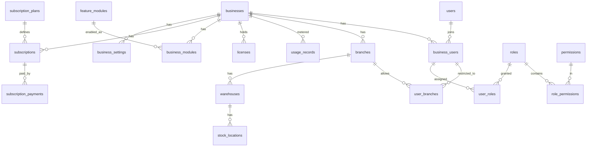
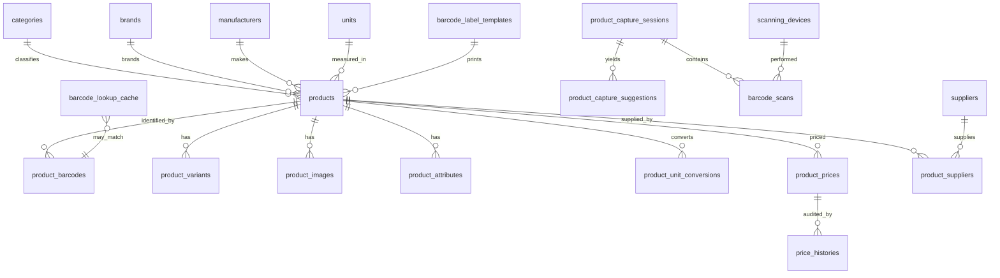
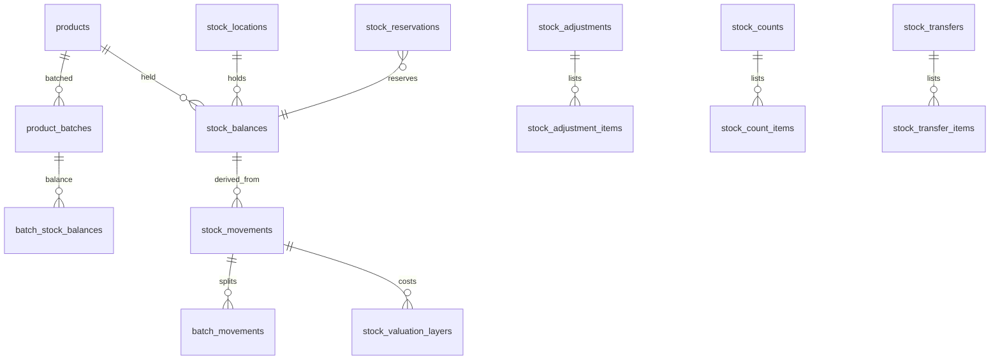
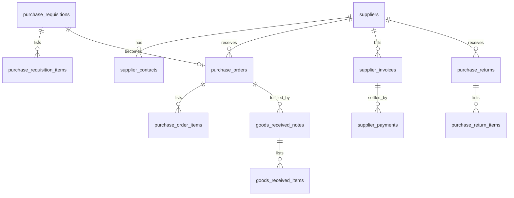
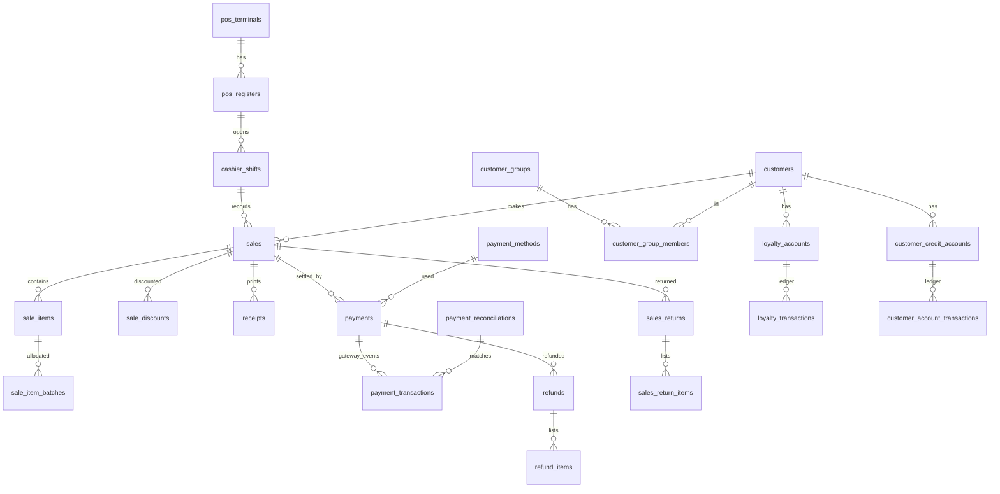
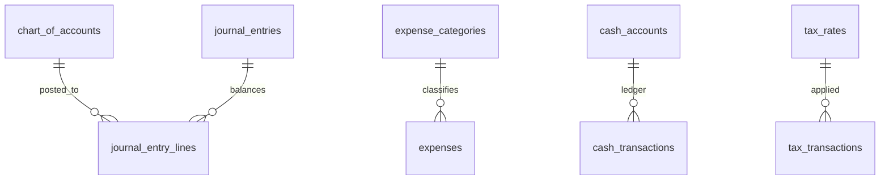
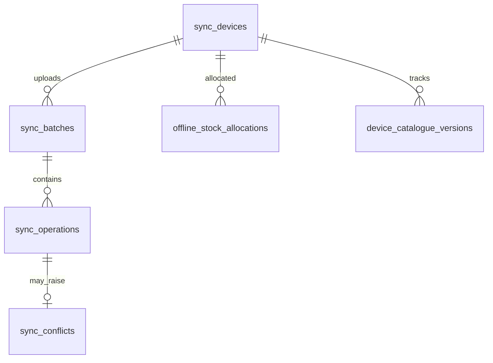
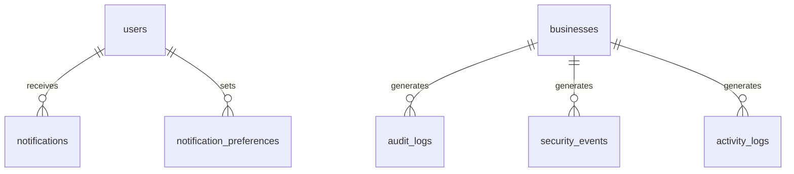

# StockPulse ER Diagram (planning draft)

Conventions: every tenant table also has `business_id`; branch-scoped tables have `branch_id`. Full column lists are in DATABASE_SCHEMA.md. Diagrams are split by domain for readability.

## Platform and access

## Catalogue and barcode

## Inventory

## Procurement

## Sales, payments, customers

## Finance

## Offline sync

## Administration

## Additional tables proposed (beyond baseline)
- idempotency_keys: replay protection for write endpoints.
- webhook_events: payment callback signature/replay records.
- document_sequences: per-business, gap-free document numbering.
- failed_login_attempts, trusted_devices: brute-force tracking, MFA/device trust.
